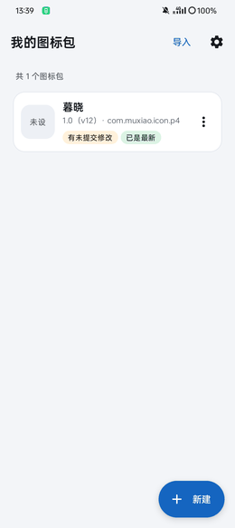
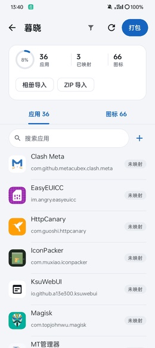
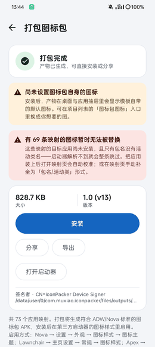
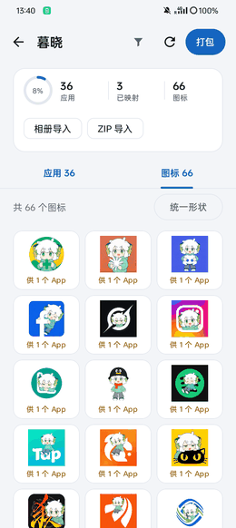
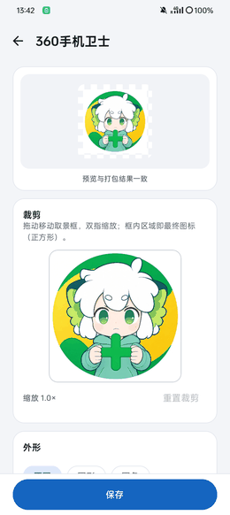
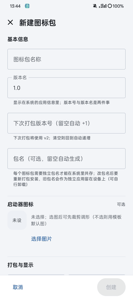
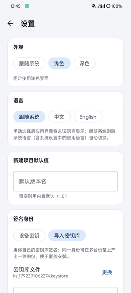
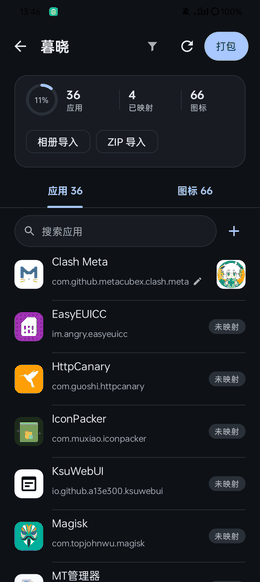

# IconPacker

**在手机上从零做一个图标包：导入图标 → 映射应用 → 端上打包签名。**

**Build an icon pack from scratch, right on your phone: import icons → map apps → pack and sign on
the device.**

[简体中文](#简体中文) · [English](#english)

-3DDC84?logo=android&logoColor=white)


|               图标包列表               |                   应用映射                   |                   打包结果                   |
|:--------------------------------------:|:--------------------------------------------:|:--------------------------------------------:|
|  |  |  |

---

## 简体中文

### 这是什么

IconPacker 是一个 Android 工具应用：挑一套图标，把它映射到手机上已安装的应用，然后 **在本机**
打包、签名，生成可直接安装的图标包 APK。安装后到支持标准图标包的启动器里启用它。

### 功能

| 能力       | 说明                                                                                                                  |
|------------|-----------------------------------------------------------------------------------------------------------------------|
| 图标包项目 | 多项目并存，名称 / 包名 / 版本 / 抽屉可见性各自独立；支持重命名、复制、删除                                           |
| 图标导入   | 单张、多选、ZIP 批量导入。导入即压缩，含透明转 PNG、不透明转 WebP，更大的原图保留不动                                 |
| 应用映射   | 列表逐条选图标，3 列图标选择器；ZIP 内含 `appfilter.xml` 时自动建映射，文件名等于包名时精确匹配；**绝不覆盖**已有映射 |
| 图标编辑   | 裁剪、外形（原图 / 圆 / 圆角 / Squircle）、缩放、可选背景与边框（默认关闭）；批量套用统一样式，可撤销                 |
| 一键打包   | 图标预处理 → 写模板槽位 → 生成 `appfilter.xml` / `drawable.xml` → 重写 ZIP → v1 + v2 + v3 签名，进度可取消            |
| 安装与产物 | 调系统安装器、分享、导出；记录版本、大小、安装状态                                                                    |
| 签名       | 默认用设备 Keystore 生成密钥；也可导入自己的 PKCS12 / JKS 密钥库。密码不落盘、不上传                                  |
| 界面       | Material 3，中英双语可切换，浅色 / 深色 / 跟随系统                                                                    |

### 怎么用

1. **建项目** —— 填名称、包名（默认 `com.muxiao.icon.p<id>`，可改）和版本号。
2. **导图标** —— 从相册 / 文件选图，或直接导入一个图标包 ZIP；选中后会先进编辑器，裁好再存。
3. **做映射** —— 在「图标映射」页逐条挑图标；顶栏筛选只看未映射项；也能切到图标库反查哪些图标没被用上。
4. **打包安装** —— 在映射页右上角点「打包」，确认页会先列出映射缺口，打包完成后直接安装，再去启动器里选这个图标包。

### 兼容性

- **系统**：Android 7.0+（minSdk 24）。映射列表只列出有桌面图标的应用。
- **启动器**：ADW、Nova 等读取标准 `appfilter.xml` 的启动器；产物清单同时声明
  `org.adw.launcher.THEMES`。
- **不支持**：类 AOSP 原生桌面（如 Pixel 默认桌面）本身不加载第三方图标包，需换用支持的启动器。
- **注意**：海外 GMS 设备对非商店分发的 APK 有开发者验证拦截，安装时可能出现提示；国内与 AOSP 环境不受影响。

### 构建

需要 JDK 17+（AGP 9.4 经 foojay 自动解析所需工具链）与 Android SDK 37。

```bash
./gradlew :app:assembleDebug     # 联动 :template 产出模板 APK，并自动跑单元测试
./gradlew :app:assembleRelease   # R8 + 资源压缩，仅保留 zh / en
./gradlew :app:testDebugUnitTest :core:packer:testDebugUnitTest
./gradlew :app:connectedDebugAndroidTest   # 需连接真机
```

任一单测失败，`assemble` 直接中止——回归挡在 APK 之前。

首次构建时，`:template` 先产出 `template-debug.apk`，再自动分发两份：`app/src/main/assets/template.apk`
（打包底座）与 `core/packer/src/test/resources/template.apk`（测试夹具）。两者都是生成物， **不入库**
，也不要手工拷贝。

### 项目结构

```
app/            Compose UI、用例编排、Room 数据层、安装引导
core/packer/    打包引擎（纯 Kotlin + 最小 Android 依赖）：
                图标预处理、AXML 编码、清单补丁、ZIP 重写、apksig 签名
template/       模板 APK 资源底座（aapt2 预编译，打包时替换内部条目）
```

### 实现要点

- **只换字节，不重编资源表**：模板的 `resources.arsc` 原样保留，打包时按槽位替换文件内容并改写 AXML
  清单。图标目录必须带密度限定符（如 `drawable-xxxhdpi`），用 `anydpi` 会让位图塌成纯色块。
- **改包名不改资源**：换包名只重写清单和 `appfilter.xml` 的映射目标，不触碰 arsc，因此全程无需 aapt2
  参与。
- **零网络**：应用没有申请 `INTERNET` 权限，所有数据都在私有目录与本地数据库里。
- **可验证**：引擎的 AXML 编码与 aapt2 34.0.0 产物做对拍测试，另有基于真实模板的端到端回读测试。

### 已知限制

- 图标包模板流程固定，暂不支持替换自定义模板。
- 海外 GMS 设备的验证拦截见上文「兼容性」。

### 许可

[GPL-3.0](LICENSE)。

---

## English

### What is this

IconPacker is an Android utility app: pick a set of icons, map them to the apps installed on your
phone, then **on the device** pack and sign them into a directly installable icon pack APK. Once
installed, enable it in a launcher that supports standard icon packs.

### Features

| Capability          | Details                                                                                                                                                                                            |
|---------------------|----------------------------------------------------------------------------------------------------------------------------------------------------------------------------------------------------|
| Icon pack projects  | Multiple projects side by side, each with its own name, package name, version and drawer visibility; rename, duplicate, delete                                                                     |
| Icon import         | Single image, multi-select, or batch ZIP import. Images are compressed on import (transparent → PNG, opaque → WebP; larger originals kept as-is)                                                   |
| App mapping         | Pick an icon per app from a 3-column picker. A bundled `appfilter.xml` seeds mappings automatically, and filenames matching package names resolve exactly. Existing mappings are never overwritten |
| Icon editor         | Crop, shape (original / circle / rounded / squircle), zoom, optional background and border (off by default); apply one style to a batch, undoable                                                  |
| One-tap build       | Preprocess icons → fill template slots → generate `appfilter.xml` / `drawable.xml` → rewrite the ZIP → sign (v1 + v2 + v3), cancellable progress                                                   |
| Install & artifacts | System installer, share, export; version, size and install state tracked per artifact                                                                                                              |
| Signing             | Device Keystore by default, or import your own PKCS12 / JKS keystore. Passwords are never persisted or uploaded                                                                                    |
| UI                  | Material 3, switchable Chinese / English, light / dark / follow system                                                                                                                             |

### Usage

1. **Create a project** — name, package name (defaults to `com.muxiao.icon.p<id>`, editable) and
   version.
2. **Import icons** — pick images from gallery / files, or import a whole icon pack ZIP. Selected
   images go through the editor first, so you crop before saving.
3. **Map apps** — choose icons on the Mapping screen; the top-bar filter shows only unmapped
   entries, and the icon library tells you which icons are still unused.
4. **Build & install** — hit **Build** in the top-right of the Mapping screen; the confirmation page
   lists mapping gaps first, then install the result and select the pack in your launcher.

### Compatibility

- **System**: Android 7.0+ (minSdk 24). Only apps with a launcher icon are listed for mapping.
- **Launchers**: ADW, Nova and others that read the standard `appfilter.xml`. The generated manifest
  also declares `org.adw.launcher.THEMES`.
- **Not supported**: AOSP-style launchers (e.g. the default Pixel launcher) do not load third-party
  icon packs — use a supporting launcher instead.
- **Note**: On GMS devices outside China, sideloaded APKs may hit Google's developer verification
  prompt. Domestic and AOSP builds are unaffected.

### Build

Requires JDK 17+ (AGP 9.4 resolves its toolchain through foojay) and Android SDK 37.

```bash
./gradlew :app:assembleDebug     # also builds :template and runs unit tests
./gradlew :app:assembleRelease   # R8 + resource shrinking, zh / en only
./gradlew :app:testDebugUnitTest :core:packer:testDebugUnitTest
./gradlew :app:connectedDebugAndroidTest   # needs a device
```

Any failing unit test aborts `assemble`, so regressions never reach an APK.

On the first build, `:template` produces `template-debug.apk`, which is then copied twice: to
`app/src/main/assets/template.apk` (the packing base) and to
`core/packer/src/test/resources/template.apk` (the test fixture). Both are generated artifacts —
**not tracked**, and never copied by hand.

### Project layout

```
app/            Compose UI, use-case orchestration, Room data layer, install flow
core/packer/    Packing engine (plain Kotlin, minimal Android deps):
                icon preprocessing, AXML encoding, manifest patching, ZIP rewriting, apksig signing
template/       Template APK resource base (precompiled with aapt2, entries replaced at pack time)
```

### Implementation notes

- **Replace bytes, never recompile resources**: the template's `resources.arsc` is preserved
  verbatim; at pack time file contents are swapped per slot and the AXML manifest is patched. Icon
  folders must carry a density qualifier (e.g. `drawable-xxxhdpi`) — `anydpi` collapses bitmaps into
  flat color blocks.
- **Renaming the package never touches resources**: only the manifest and the `appfilter.xml`
  targets are rewritten, so aapt2 is not needed at runtime.
- **Zero network**: the app declares no `INTERNET` permission; everything lives in private storage
  and a local database.
- **Verified**: the engine's AXML encoder is diffed against aapt2 34.0.0 output, plus end-to-end
  read-back tests against the real template.

### Known limitations

- The template pipeline is fixed; custom template replacement is not supported yet.
- Google's GMS verification prompt is described under "Compatibility" above.

### License

[GPL-3.0](LICENSE).

---

<details>
<summary><b>更多界面截图 · More screenshots</b></summary>

|            图标库 · Icon library            |         图标编辑 · Icon editor         |           新建图标包 · New project           |
|:-------------------------------------------:|:--------------------------------------:|:--------------------------------------------:|
|  |  |  |

|           设置 · Settings            |             深色界面 · Dark mode             |
|:------------------------------------:|:--------------------------------------------:|
|  |  |

</details>
